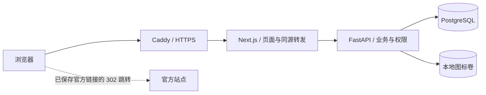
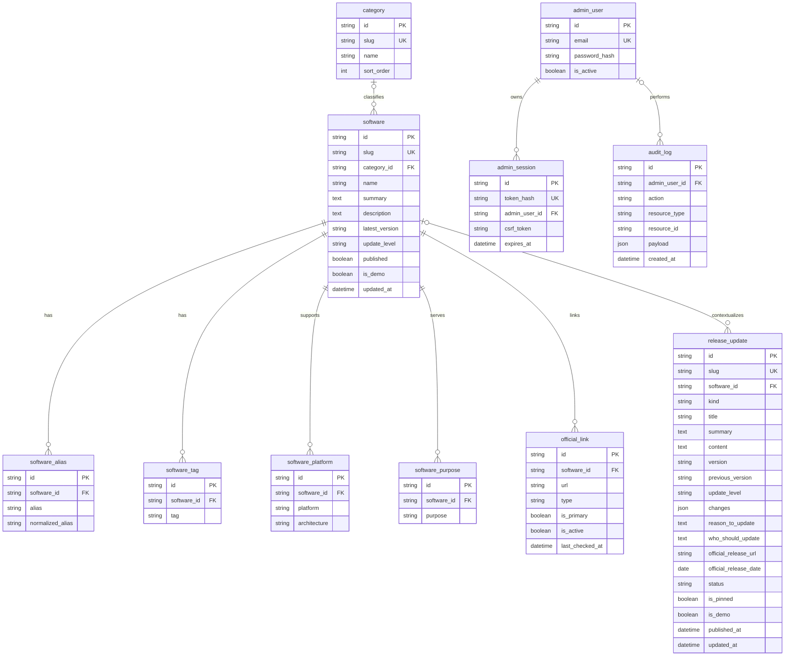

# 公告中心架构

软件模型、管理认证与公开目录沿用首轮工程；当前迭代新增公告实体与人工发布流程，公开信息层级以公告为核心。`product-positioning.md` 定义当前定位，`announcement-test-report.md` 记录实际验收；自动版本检测、主动消息发送、广告和普通用户账号没有纳入实现。

## 请求与数据路径

公开页面由 Next.js 服务端读取 API；浏览器筛选、管理写入和图标上传走同源路径。API 是公开状态、输入校验、认证、CSRF 与数据写入的最终边界。客户端隐藏操作按钮不能替代服务端权限检查。

生产 Compose 仅 Caddy 暴露 80/443；Web、API 与 PostgreSQL 位于容器网络中。后端网络不允许直接外连，当前功能不需要主动抓取官方 URL。开发 Compose 仅向 `127.0.0.1` 暴露 3000/8000/5432。

## 已实现实体

ERD 展示关键字段；完整定义以 `apps/api/app/models/entities.py`、`apps/api/app/models/updates.py` 与迁移为准。UUID 使用字符串存储，便于 PostgreSQL 和本地 SQLite 共用模型。别名保存归一化字段；分类、平台、发布状态等查询条件有相应索引。分类可为空，被软件引用的分类不能直接删除。

`release_update` 统一表示版本更新（release）、使用提醒（notice）与维护通知（maintenance）。软件关联可为空，以支持站点通用通知；版本更新发布时要求关联已公开软件。正文、影响范围、行动建议、变化、注意事项和来源共同构成公告，不能由软件介绍替代。

分类、别名、标签、用途和平台仍由管理员维护。官方链接绑定软件，跳转由数据库 ID 解析；公开目录只读取已发布软件，跳转还要求链接启用。

## 公告读取与发布

公开入口为首页、`/updates` 与 `/update/{slug}`。公告列表只读取 `status=published`，且关联软件须仍为公开状态；无软件关联的通用通知不受该关联条件限制。排序依次为置顶、发布时间倒序、创建时间倒序及稳定 ID。草稿、待审核与归档仅供管理员读取。

发布与普通保存使用不同管理动作。草稿可以先进入待审核，也可以核对完成后直接通过独立的发布接口确认；请求必须显式携带 `confirmed=true`。普通保存不能转换为已发布 / 已归档。修改已发布内容需要对合并后的完整对象重新验证，公告、符合条件的软件当前版本变化和审计在同一事务中提交。

## 当前版本如何确定

软件当前版本由已发布过的版本更新公告决定，使用官方发布日期倒序；未填写官方日期时，退回首次发布时间的 UTC 日期。同一日期再按首次发布时间及稳定 ID 排序，不按版本字符串字典序比较。首次发布时间不会因修正文案或重新发布而刷新；公告首次发布后，类型、关联软件、官方发布日期和演示标记不可再修改。

因此，修订旧公告、重新发布旧记录，或补录填写了真实较早官方日期的历史版本，都不会覆盖较新版本。补录旧版本必须提供真实官方日期；没有日期时，系统无法凭任意格式的版本文字推断历史顺序。

归档只控制公告可见性，仍保留已发生的版本事实，不回退软件当前版本。后续编辑较旧公告也不会借归档触发回退。演示公告不会修改真实软件的版本或将其标记为演示；真实公告选取版本依据时排除演示公告。演示公告与演示软件之间允许同步演示资料，第一条真实版本公告可以将演示资料更新为真实软件事实。

首次发布顺序、官方日期、公告状态和演示标记共同决定同步结果；软件、公告和审计使用同一数据库事务，并对并发发布涉及的记录加行锁。真实 PostgreSQL 的回归结果见本轮验收报告。

群通知从公告内容生成纯文本或 Markdown，经管理员明确操作复制到剪贴板。复制接口要求认证及当前公告可公开读取；没有聊天平台、邮件或推送发送集成。

## 管理与状态

密码使用 Argon2id 散列。登录生成随机 session token，浏览器收到 HttpOnly Cookie，数据库保存 token 散列与过期时间。修改请求同时校验 session 与 CSRF。软件下线使用 `published=false` 保留记录；管理变更写入审计日志。

轻量关注保存在当前浏览器本地，不创建普通用户账号，不跨设备同步，也不会发送通知。

## 运行边界

- 当前部署为单 API 进程。限流使用进程内存，多副本部署前必须改为共享存储。
- 数据库结构由 Alembic 管理；种子与创建管理员是显式命令。
- 图标在本地持久化卷中，公开静态访问；本轮没有对象存储和图标自动清理。
- `/health` 用于进程存活检查，`/ready` 用于数据库就绪检查。
- 没有 Redis、任务队列、版本抓取器或实时同步。后续扩展必须增加对应运行组件、迁移和测试。

生产文件是部署基础配置；容量、并发、实际 TLS、容器启动及恢复流程仍需要目标环境验收。

## 2026-09-26 内容与运营扩展

新增 ContentDocument / ContentItem 领域：通过 kind 区分指南、FAQ和合集，指南保存纯文本正文与有序步骤，FAQ保存问题与答案，合集保存有序软件成员、选择理由和推荐程度。公开查询在数据库层限制发布状态和关联软件可见性，序列化前再次过滤未公开成员；空的公开合集不暴露给用户。

后台保存只产生草稿，发布必须独立确认；已发布内容先下线再修改，避免保存时意外公开。内容变更与审计在同一事务处理。现有公告、历史补录、当前版本源指针等不变量保持独立。

Finder在已有名称、别名、用途和标签范围匹配描述，不调用AI、不推断本机安装状态。新手流程与合集只使用公开内容，关注ID由浏览器存储；系统限制存储时真实使用页面内存并告知刷新会丢失。

AnalyticsDaily按UTC日期和事件/范围/关键词或官方链接聚合，使用SQLite/PostgreSQL各自的原子upsert。搜索仅由可见客户端页面触发，不在服务器渲染或链接预取时计数；官方入口在成功的受控跳转时计数。普通搜索词经格式过滤后最长80字符，明显身份/凭据模式不存原词，不保存IP、会话或访客标识；启动、每日和写入时清理90天以前数据，亦有手工清理CLI。统计写入失败不阻断官方跳转。后台工作台以这些真实计数和已公开软件的内容缺口组织维护任务。

SEO补齐指南/FAQ/合集公开页的标题、描述、canonical和sitemap；真实内容提供Article/FAQPage/ItemList结构化数据，演示内容不加入内容sitemap并使用noindex。结构化JSON同样转义HTML起始字符，所有正文以React普通文本呈现。
